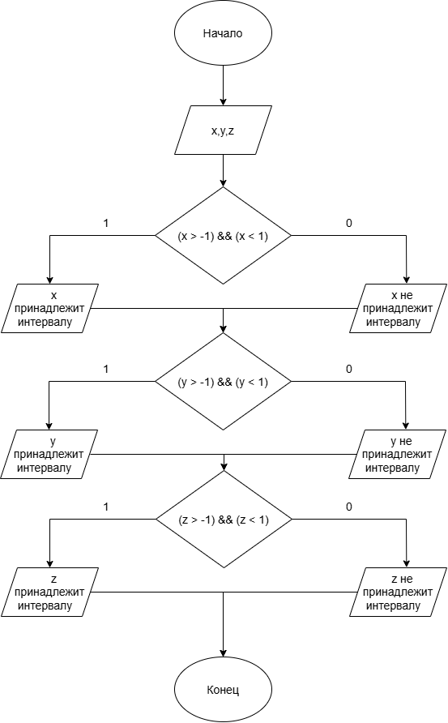

# Домашнее задание к работе номер 6
## Условие задачи
Даны три вещественных числа. Выбрать из них те, которые принадлежат интервалу (-1, 1).
## 1. Алгоритм и блок-схема
### Алгоритм:
1. Начало.
2. Объявить переменные:
- **x**
- **y**
- **z**
3. Составить условия и определить, принадлежат числа промежутку или нет.
4. Конец.
### Блок-схема:

## 2. Реализация программы
```c
#define _CRT_SECURE_NO_WARNINGS
#include <stdio.h>
#include <locale.h>

void main() {
    setlocale(LC_CTYPE, "RUS");
    double x, y, z;
    puts("введите x:");
    scanf("%lf", &x);
    puts("введите y:");
    scanf("%lf", &y);
    puts("введите z:");
    scanf("%lf", &z);
    if ((x > -1) && (x < 1)) {
        puts("х принадлежит интервалу");
    }
    else {
        puts("х не принадлежит интервалу");
    }
    if ((y > -1) && (y < 1)) {
        puts("y принадлежит интервалу");
    }
    else {
        puts("y не принадлежит интервалу");
    }
    if ((z > -1) && (z < 1)) {
        puts("z принадлежит интервалу");
    }
    else {
        puts("z не принадлежит интервалу");
    }
}
```
## 3. Результаты работы программы
Пример:
введите х:
0.2
введите y:
1
введите z:
-0.5

х принадлежит интервалу
y не принадлежит интервалу
z принадлежит интервалу
## 4. Информация о разработчике
Литуновский Максим Дмитриевич, бТИИ-261